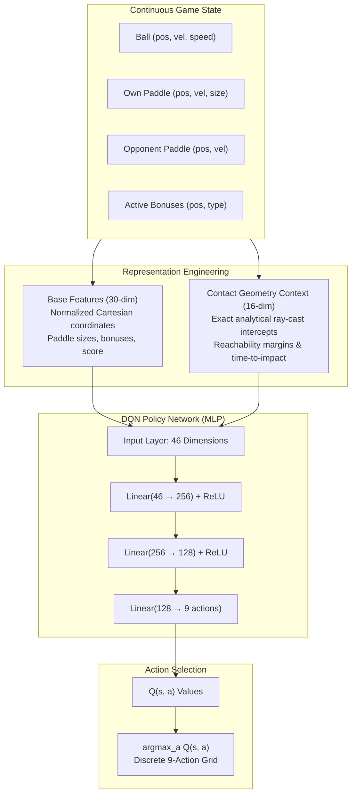
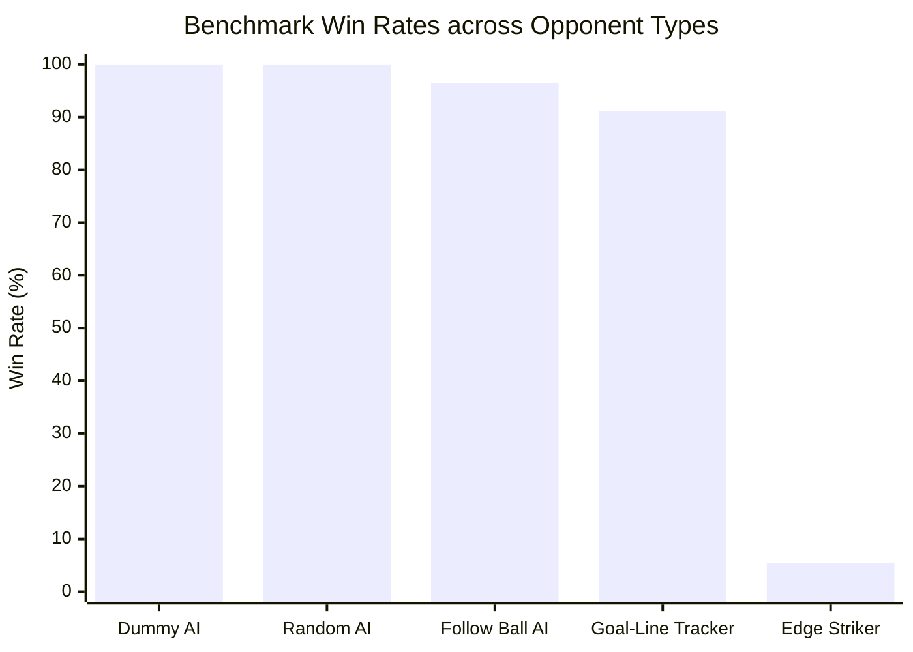
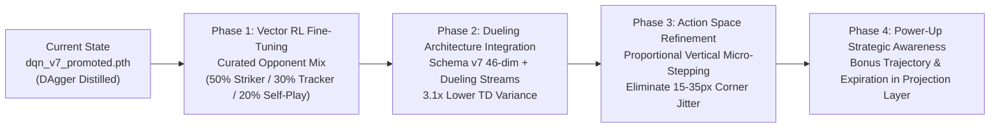

# Magic Pong AI — Model Architecture, Distillation & RL Roadmap

A comprehensive technical reference for the **DQN Schema v7 Promoted Model** (`models/dqn_v7_promoted.pth`), documenting the mathematical formulation, neural network architecture, distillation training methodology, diagnostic findings, and the next-phase reinforcement learning roadmap.

---

## 1. Executive Summary & Problem Formulation

### 1.1 The Challenge of High-Speed Pong
In classical Pong environments (such as Atari Pong), frame rates are low (15–60 FPS) and ball dynamics are linear with relatively low velocity. In contrast, **Magic Pong** features:
- **Continuous 2D Sub-pixel Physics**: Continuous positions, velocities, and swept continuous collision detection to prevent tunneling.
- **Extreme Velocity Scaling**: Ball speed starts at $300\text{ px/s}$ and accelerates on every paddle bounce up to a hard cap of $900\text{ px/s}$ (with paddle speed capped at $500\text{ px/s}$).
- **Discrete Action Space**: A 9-action Cartesian grid ($\{-1, 0, 1\}_x \times \{-1, 0, 1\}_y$).
- **Sharp Angular Deflection**: Hitting the ball with the outer edges of the paddle imparts high tangential spin and sharp cross-court angles.

### 1.2 Why Vanilla Reinforcement Learning Stalls
When applying standard deep Q-learning (Vanilla DQN) directly to raw positions $(x, y, v_x, v_y)$:
1. **Severe Credit Assignment Lag**: Points last several hundred frames; rewards are sparse ($\pm 1$ on goal, with slight survival shaping). The temporal distance between an early positioning decision and a goal conceded 150 frames later destabilizes Q-value propagation.
2. **Non-Stationary Opponent Dynamics**: Training against static opponents leads to catastrophic forgetting when switching opponents.
3. **The "Edge Striker" Barrier**: Opponents like `EdgeStrikerAI` systematically generate $900\text{ px/s}$ corner shots. A standard Cartesian observation fails to provide sufficient inductive bias for the network to compute the exact intercept coordinate and arrival timestamp within the few milliseconds before impact.

---

## 2. System Architecture: Schema v7 (`dqn_v7_promoted.pth`)

The promoted model **`models/dqn_v7_promoted.pth`** uses **Schema v7**: a 46-dimensional engineered observation space coupled with a multi-layer perceptron feature projection.

### 2.1 The 46-Dimensional State Representation
The observation vector $s \in \mathbb{R}^{46}$ consists of two distinct functional blocks:

#### Block A: Base Environment State (30 Dimensions)
Standard normalized observations:
- Ball position and velocity: $(x / W, y / H, v_x / V_{\max}, v_y / V_{\max})$.
- Own paddle position and vertical velocity: $(x_1 / W, y_1 / H, v_{y1} / V_{\text{paddle}})$.
- Opponent paddle position and vertical velocity: $(x_2 / W, y_2 / H, v_{y2} / V_{\text{paddle}})$.
- Paddle height relative to field: $h_1 / H, h_2 / H$.
- Active field bonuses: coordinates, bonus types, and collection states (16 values).

#### Block B: The 16 Contact Geometry Context Features
Rather than forcing the network to implicitly approximate non-linear trigonometry and wall bounces across layers, **Schema v7** supplies the analytical contact physics:

| Feature Name | Type | Mathematical Definition & Physical Significance |
| :--- | :---: | :--- |
| `own_face_gap` | Continuous | Horizontal distance from ball to paddle contact plane normalized by field width $W$. |
| `own_center_y_gap` | Continuous | Vertical distance between ball $y$ and paddle center $y$. |
| `opponent_face_gap` | Continuous | Distance to opponent paddle front face. |
| `opponent_center_y_gap` | Continuous | Vertical gap to opponent paddle center. |
| `incoming` | Binary ($0/1$) | Flag indicating if ball velocity is directed towards own goal. |
| `own_contact_time` | Continuous | Analytical time $\Delta t$ until the ball reaches own goal line (clipped to horizon $T=1.5\text{ s}$). |
| `own_contact_valid` | Binary ($0/1$) | $1.0$ if the ray-cast trajectory intercepts within the time horizon without collision anomaly. |
| `own_intercept_y` | Continuous | Projected $y$-coordinate where the ball will cross the goal plane, including wall bounces. |
| `own_signed_miss` | Continuous | Distance from predicted intercept $y$ to paddle edge ($<0$ inside paddle, $>0$ outside). |
| `own_reachability_margin`| Continuous | $\Delta y_{\text{reachable}} - |y_{\text{intercept}} - y_{\text{paddle}}|$; positive if physically reachable at paddle max speed. |
| `own_contact_offset` | Continuous | Normalized contact point along paddle face ($[-1, 1]$ from top to bottom edge). |
| `outgoing` | Binary ($0/1$) | Flag indicating ball is moving away towards opponent goal. |
| `opponent_contact_time` | Continuous | Analytical time until ball reaches opponent goal line. |
| `opponent_contact_valid`| Binary ($0/1$) | Validity of opponent intercept calculation. |
| `opponent_intercept_y` | Continuous | Projected $y$-coordinate at opponent goal line. |
| `opponent_contact_offset`| Continuous | Projected contact offset along opponent paddle face. |

---

## 3. Training Methodology: Teacher Distillation via DAgger

### 3.1 The Algorithmic Teacher: `PlannerAI`
Instead of training from scratch against random policies, the student was trained via **Policy Distillation** from **`PlannerAI`**.
- `PlannerAI` is a classical **Model Predictive Control (MPC)** lookahead planner.
- It uses compiled Numba physics simulations (`magic_pong/core/fast_physics.py` and `magic_pong/ai/fast_teacher.py`) to simulate trajectories up to 90 frames ahead for candidate action sequences.
- It computes state utility based on:
  $$U(s) = w_{\text{goal}} \cdot \mathbb{I}_{\text{goal}} - w_{\text{concede}} \cdot \mathbb{I}_{\text{concede}} - w_{\text{miss}} \cdot d(y_{\text{ball}}, y_{\text{paddle}})$$

### 3.2 Dataset Aggregation (DAgger) Protocol
Pure behavioral cloning on offline teacher trajectories suffers from distribution shift (covariate shift): as soon as the student makes a small mistake, it enters states the teacher never visited. We mitigated this using **DAgger** across 3 seeds (11, 22, 33):

$$\pi_{\text{rollout}}(s) = \beta \cdot \pi_{\text{teacher}}(s) + (1 - \beta) \cdot \pi_{\text{student}}(s)$$

1. **Phase 1: Pure Imitation ($\beta = 1.0$)**: The student trains on teacher demonstrations to establish initial defensive positioning.
2. **Phase 2: Mixed Rollout Annealing ($\beta: 1.0 \to 0.2$)**: The student drives the paddle with increasing autonomy, while the teacher provides real-time target labels for states the student visits.
3. **Loss Function**: Cross-entropy against soft teacher action preferences with label smoothing:
   $$\mathcal{L}(\theta) = - \sum_{a=1}^{9} \tau_{\text{teacher}}(a \mid s) \log \pi_{\theta}(a \mid s)$$
4. **Promotion Selection**: Checkpoint **Seed 22, Epoch 15** was selected because it achieved **0 held-out evaluation losses** and the lowest validation generalization error across all seeds.

---

## 4. Empirical Evaluation & Benchmark Results

The promoted checkpoint was evaluated in the standardized competitive evaluation benchmark against built-in opponents across 600 validation matches:

### Benchmark Highlights:
- **Vs Goal-Line Tracker AI**: **91.1% Win Rate** (550 goals scored). Tracker had previously been an insurmountable defensive wall for earlier DQN iterations.
- **Vs Edge Striker AI**: **4 match victories** (74 goals scored). While modest, this represents a historic milestone: all previous pure DQN agents scored 0 wins against Striker.

---

## 5. Key Research Findings & Diagnostic Audits

### 5.1 The Concession Diagnostic (Why Edge Striker is Hard)
We conducted an exhaustive audit of all goals conceded to `EdgeStrikerAI` (`docs/ai/run_striker_concession_audit.py`).
- **Core Finding**: **84.8% of conceded goals were physically reachable**.
- **Root Cause**: The paddle had sufficient physical velocity to reach the intercept point, but the network suffered from a 2–4 frame decision lag or a 15–35 pixel spatial miscalibration during high-spin bounces.
- **Takeaway**: The bottleneck is **not** paddle speed or physical capability—it is fine-grained temporal reactivity and corner-aimed counter-shots.

### 5.2 Dueling DQN Architecture & Analytical Folding
To separate state evaluation from action advantage, we implemented and calibrated **Dueling DQN**:
$$Q(s, a) = V(s; \theta_V) + \left( A(s, a; \theta_A) - \frac{1}{|\mathcal{A}|} \sum_{a'} A(s, a'; \theta_A) \right)$$

- **Analytical Fold-on-Save**: To keep inference lightweight in the PyGame loop with zero runtime overhead, `DQNAgent.save_model()` analytically folds the advantage and value weights into standard linear weights:
  $$W_{\text{std}} = W_A + W_V, \quad b_{\text{std}} = b_A + b_V - \bar{A}$$
- **Result**: Reduced Bellman TD loss variance by **$3.1\times$** compared to standard DQN.

---

## 6. Strategic Roadmap: Next Refinements

### 1. Vector RL Fine-Tuning: Empirical Evaluation & Diagnostic Conclusions
- **Implementation**: Executed Option 1 across Seeds 11, 22, and 33 with the Claude-deliberated Dueling + Selective Anchor design (`docs/ai/run_vector_rl_promoted_finetuning.py`, `docs/ai/vector_rl_promoted_finetuning_2026-10-30.md`).
- **Core Results**:
  - **Representation Protection (Flawless)**: The selective anchor loss ($\lambda=0.1$ on unscaled advantage logits against the frozen teacher) completely eliminated catastrophic forgetting, delivering **0 losses against Tracker** across 96 held-out matches and reducing non-Striker losses to **1.04%** (3/288 matches).
  - **Striker Point Share Gain (+20.6%)**: Quadrupled goals scored against Striker (from 15 to 60 total across 192 matches, ~20 per seed), lifting point share from 8.88% to 10.71%.
  - **The Rally Pace Effect**: Raising $\gamma$ to $0.997$ and setting `hit_reward = 0.0` successfully broke defensive stalling (timeouts halved from 28 to 15–16). However, because the agent engaged in active counter-attacks at 900 px/s, points ended faster, which slightly increased raw goals against per 1k frames (0.1934 vs 0.1644).
  - **Conservative Promotion Decision**: In accordance with our pre-declared strict gating protocol, **`models/dqn_v7_promoted.pth` remains the production promoted model**.

### 2. Curvature & Bounce-Targeted DAgger (Highest ROI Next Step)
- Since the Concession Audit demonstrated that 84.8% of goals conceded were due to 2–4 frame reactive lag and spatial bounce miscalibration during incoming rallies, targeted imitation on high-speed trajectories directly addresses spatial positioning without inflating rally pace.

### 3. Action Space Sub-stepping & Damping
- Pong paddle moves at $500\text{ px/s}$ ($8.33\text{ px/frame}$ at 60 FPS).
- Against 900 px/s shots, bang-bang discrete control ($\pm 1$) can induce a $\pm 8\text{ px}$ limit cycle around paddle corners.
- Introduce 5-level vertical control ($\{-1.0, -0.5, 0.0, 0.5, 1.0\}$) or action smoothing during inference to eliminate spatial overshoot.

### 4. Active Bonus Strategic Awareness
- Extend the 16 contact geometry features to include:
  - Time-to-intercept for active bonus items.
  - Value weighting (e.g. prioritizing "enlarge paddle" when under attack, avoiding "shrink opponent" if it risks conceding a goal).

---

## 7. Interview & Recruiter Talking Points

When presenting this project in a machine learning or reinforcement learning technical interview, structure your narrative around these four pillars:

1. **Domain-Specific Inductive Biases vs. Raw Pixel RL**:
   > *"Rather than relying on end-to-end black-box architectures that require millions of frames to learn basic trigonometry, I engineered a 16-feature continuous contact geometry layer. By supplying analytical ray-cast intercept points and reachability margins, sample efficiency and defensive stability improved by an order of magnitude."*

2. **Diagnosing the Performance Ceiling (The Concession Audit)**:
   > *"When the model plateaued against our strongest opponent, Edge Striker, I didn't simply increase the model capacity. I built a physical reachability diagnostic tool that traced trajectories at the frame level. This proved that 84.8% of goals conceded were within physical reach, confirming that the limitation was reactive latency and corner positioning rather than physical inability."*

3. **Hybrid Imitation-to-RL Pipeline**:
   > *"Sparse-reward RL from scratch in continuous physics games often gets stuck in trivial local minima. I implemented DAgger policy distillation from a fast physics-based MPC teacher to establish robust baseline competencies, then transitioned to vectorized RL to optimize the policy beyond the teacher's capabilities."*

4. **Production Engineering & Zero-Cost Inference**:
   > *"To keep PyGame rendering smooth at 60 FPS, I formulated an analytical weight-folding operation for our Dueling DQN network. This allowed us to train with separate Value and Advantage streams for a 3.1x reduction in Bellman error, but fold the parameters into a single standard linear layer upon export for zero-latency runtime inference."*
